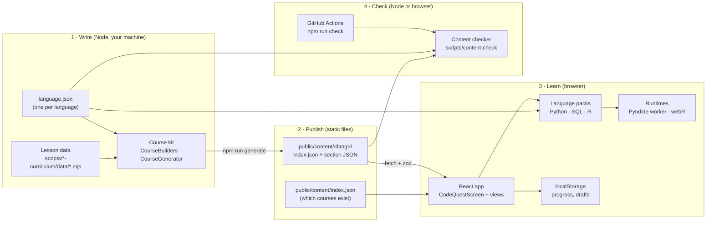
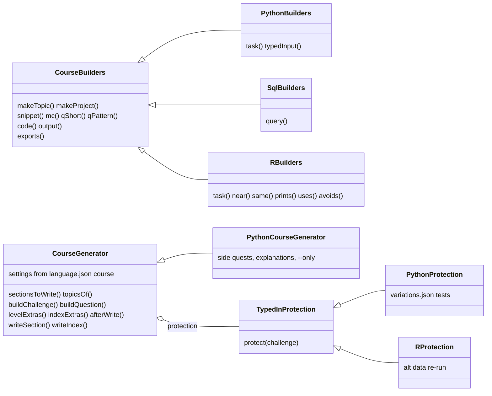
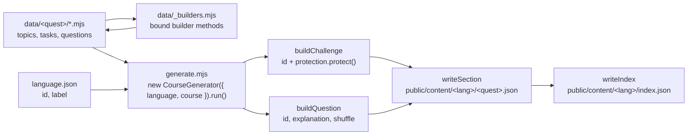
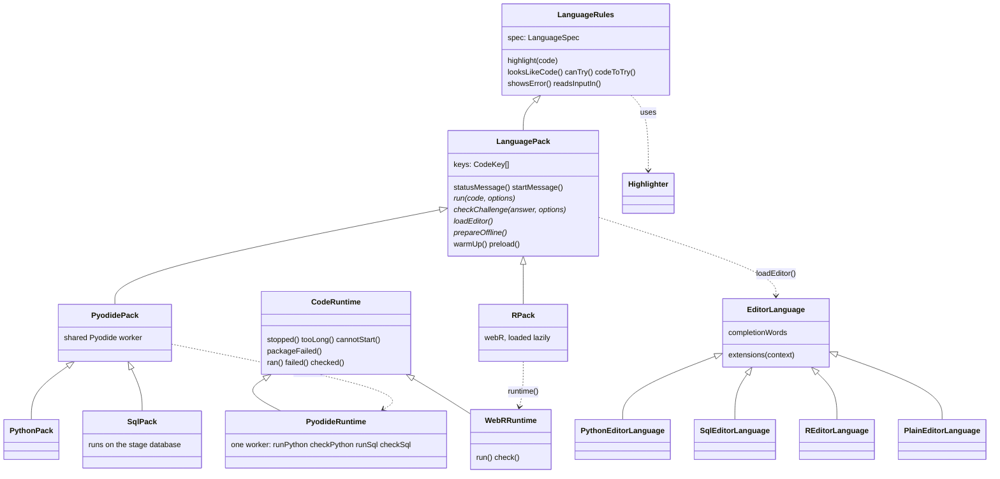
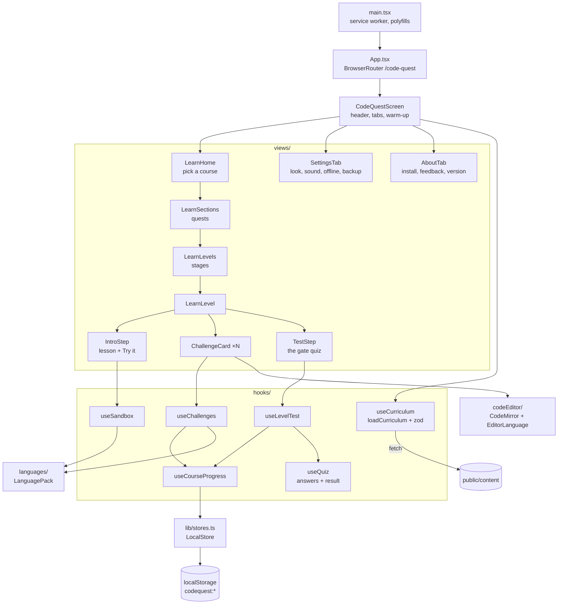
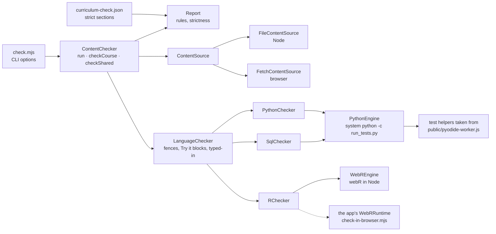
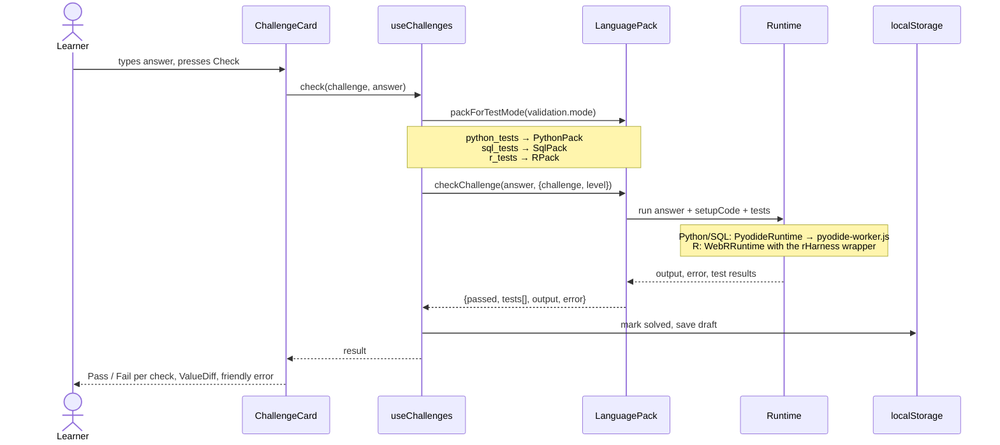
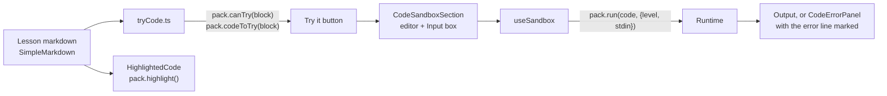

# CodeQuest architecture

Where each part of the app lives and how the parts talk to each other. **Level 1** is the whole system, **Level 2** zooms into each part, and **Level 3** follows one action from click to result.

Contents:
- Level 1: [The whole system](#the-whole-system) · [Where things live](#where-things-live)
- Level 2: [Building a course](#building-a-course) · [Language packs](#language-packs) · [The app](#the-app) · [Content checker](#content-checker)
- Level 3: [Pressing Check](#pressing-check) · [Try it and Run](#try-it-and-run) · [Adding a language](#adding-a-language)

---

## Level 1

### The whole system

Four zones: write, publish, learn, check. You write lessons as JavaScript in `scripts/`. A generator turns them into JSON under `public/content/`. The React app fetches that JSON and runs learners' code in the browser. The content checker runs every solution before anything ships.

One `language.json` per language feeds all three sides: the generator, the app's language pack and the checker. That file is the single place for language specifics.

| Language | Runs on |
|---|---|
| Python | Pyodide in a Web Worker (`public/pyodide-worker.js`) |
| SQL | SQLite through Pyodide's `sqlite3`, in the same worker |
| R | webR, loaded from its CDN (admin-only for now) |

### Where things live

| Folder | What is in it | Runs in |
|---|---|---|
| `scripts/course-kit/` | Base classes shared by every course: `CourseBuilders`, `CourseGenerator`, `TypedInProtection`. | Node |
| `scripts/<lang>-curriculum/` | One course: `builders.mjs`, `generator.mjs`, `protection.mjs`, `generate.mjs`, and `data/` with one folder per quest. | Node |
| `scripts/content-check/` | The content checker: `check.mjs` CLI, `ContentChecker`, `Report`, one checker per language, the engines and the Python runners. | Node, or the browser for R |
| `public/content/` | Generated lesson JSON the app fetches. `index.json` lists the courses; each course folder has its own `index.json` plus one file per quest. | Static files |
| `public/pyodide-worker.js` | The Web Worker that loads Pyodide and runs Python and SQL. It also holds the test helpers the checker reuses. | Browser worker |
| `src/features/languages/` | Everything about each language: per language a folder with `language.json`, its pack, editor and error classes (and R's `WebRRuntime`); `pyodide/` for the Python worker shared by Python and SQL; `runtime/` for the `CodeRuntime` base class; plus the shared `Highlighter`, the base phone keys (`keys.json`) and the registry in `index.ts`. | Browser (rules also load in Node) |
| `src/features/curriculum/` | The learning screens: views, components, hooks, code editor and sandboxes. `content/` loads and validates the course JSON and grades answers; `progress/` saves progress and handles backups, the streak and renamed lessons. | Browser |
| `src/lib/` | `localStore.ts`, a typed value saved in the browser, and `stores.ts`, the list of every saved value and which ones go in a backup. | Browser |
| `src/components/` | Shared pieces: the bottom bar, the install banner, `Sheet` (every pop-up), `ConfirmDialog`. | Browser |
| `src/features/…` | Badges, certificates, ranks, review, reminders, sound, support, feedback. | Browser |

---

## Level 2

### Building a course

Each course subclasses three base classes and only overrides what is different. The lesson files import a thin `data/_builders.mjs`, which exports the bound methods of that course's builders.

- **Typed-in protection** stops an answer that just types the expected value from passing. Python re-runs the answer with other inputs from `variations.json`. R re-runs it on different data given as `alt`. SQL needs none, because queries run against a whole table.
- **What differs between courses:** mostly settings, in the `course` block of each `language.json`: SQL copies each lesson's `database` into its level, and R shuffles quiz choices and leaves out the questions' internal `check` field. SQL and R use `CourseGenerator` as it is; only Python has a subclass, for `--only` and an index that lists every quest. Python's side quests and quiz explanations are data too: `projects` in `data/course.mjs`, and each question's explanation next to it.

### Language packs

`language.json` holds everything that is data: keywords, built-ins, colouring patterns, its changes to the phone keys, how "Try it" spots code, what counts as an error demo, the test mode, indent size, how long code may run and how a run that went wrong is worded. zod validates it in `languageSpec.ts`. The classes add only what has to be code: running it, and the editor support.

- **The registry:** `src/features/languages/index.ts` creates the packs once in `LANGUAGE_PACKS` and looks them up with `languagePack(id)`, `packForTestMode('r_tests')` and `loadEditorLanguage(id)`.
- **Runtimes:** each runtime class extends `CodeRuntime`, which turns a Stop, a run past the time limit, a failed download or the tests' results into the same result types for every language, worded by the language's `language.json` (`limits.runSeconds`, `messages.errors`).
- **Phone keys:** `keys.json` is the key bar every language starts from. A language's `keys` only lists what it adds (placed after the indent keys) and what it removes; code without a language gets the base set (`keyBar.ts`).
- **Loaded on demand:** runtimes and editor classes come in through dynamic `import()`, so opening a Python lesson never downloads webR. The app warms the pack up 1.5 s after a course opens.
- **Shared with Node:** `LanguageRules` uses `.ts` imports that Node can load with types stripped. That lets the content checker use the same "Try it" and colouring rules as the app.

### The app

`CodeQuestScreen` hands each hook's state to `LearnLevel` whole (`sandbox`, `challenges`, `test`), so a new feature in a hook doesn't need a new prop on every screen in between. The skip-ahead gate and the daily review use `useQuiz` and `PracticeQuiz`, the same answers-and-result logic as a stage's gate.

Other features (badges, ranks, certificates, review, reminders, settings) save through the stores in `src/lib/stores.ts`. Each store says whether it is learner data (it goes in a backup) or a device setting (it doesn't), so a new saved value is backed up by adding one line there. Every store sends one change event, so screens showing a value update when it changes, including after a restore.

### Content checker

Run with `npm run check:content`, or `npm run check:r` for R only. Options include `--language`, `--section`, `--all-strict`, `--verbose` and `--require-engines`. It exits with 1 when something fails, and with 2 when a language engine was missing but required.

- **Shared rules:** `checkShared` looks for an empty prompt, a missing hint or solution, quiz patterns that don't match, and challenges a plain text match would pass.
- **Language rules** (the verdicts are shared in `LanguageChecker`): each solution must pass and each starter must fail. Every "Try it" sample must run. Error demos must actually fail. Typed-in answers must not pass where the section is strict.

---

## Level 3

### Pressing Check

Stop works the same for every language: the pack gets an `AbortSignal`. A run past the language's time limit (`limits.runSeconds`: 10 s for Python and SQL, 45 s for R) is stopped too. Either way the runtime is thrown away (the Python worker, or webR) and started again on the next run.

### Try it and Run

The rules for which blocks get a Try it button, and which ones are error demos, come from the pack's `language.json`. The Input box only shows when `readsInputIn` finds code that reads input.

### Adding a language

The files to touch for JavaScript (HTML works the same way):

1. `src/features/languages/javascript/language.json`: keywords, colouring, its key-bar changes (`add`, `remove`), Try it rules, `testMode: "javascript_tests"`, the time limit and its error wording.
2. A runtime class that extends `CodeRuntime`, and `JavaScriptPack.ts` that extends `LanguagePack`: `run`, `checkChallenge`, `loadEditor`, `prepareOffline`, `errorSummaryLine`.
3. `JavaScriptEditorLanguage.ts` extends `EditorLanguage`, then add the pack to `LANGUAGE_PACKS` in `index.ts`.
4. `scripts/javascript-curriculum/`: a `builders.mjs` subclass with `task()`, a generator subclass, a protection subclass if needed, `generate.mjs` and `data/`.
5. `scripts/content-check/`: a `JavaScriptChecker` and an engine, registered in `check.mjs`.
6. Add the course to `public/content/index.json` (with `comingSoon` until it is ready).

The full guide is in [`src/features/languages/README.md`](src/features/languages/README.md).
