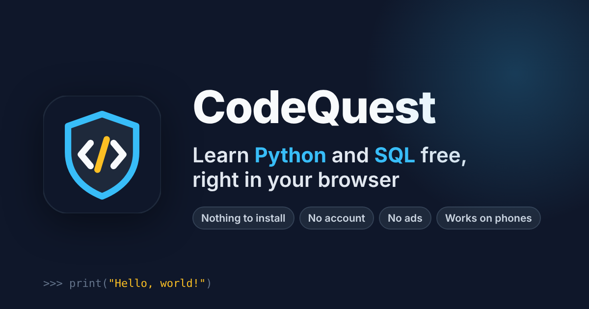

<p align="center">
  
</p>

# CodeQuest

**Learn to code for free, right in your browser.** CodeQuest teaches Python and SQL through quests: each quest is a series of short stages with hands-on challenges, and each stage ends with a gate, a short quiz that opens the next one. Your code runs on your own device, so there is nothing to install, no account to create and no ads.

### [Start learning now](https://ubuntu-apps.github.io/code-quest/)

Open the link on a laptop, a school Chromebook, a tablet or a phone, press **Start your Quest**, and you are writing your first line of Python within a minute.

## Why CodeQuest

- **Free, with no catch.** No ads, no paywall, no sign-up.
- **Nothing to install.** Python and SQL run inside the browser, so it works on locked-down school and work computers too.
- **Made for phones as well as laptops.** A phone-friendly code editor with extra keys for brackets, quotes and indents.
- **Learn by doing.** Every stage has a live sandbox and challenges that run your code and tell you exactly which characters of the output were different.
- **Keeps you going.** XP and ranks, a daily streak with streak freezes, 23 badges, an optional calendar reminder and a daily review of gate questions you got wrong.
- **Works offline.** Install it like an app and download the quests for a plane, a train or a patchy connection.
- **Certificates.** One for each quest you finish and one for the whole course. Save them as an image or print them.
- **Private.** Your progress stays on your device. CodeQuest only sends anonymous counts (such as "someone cleared the Variables gate"), with no cookies, and you can turn that off on the About tab. See the [privacy statement](PRIVACY.md).

## Courses

| Course | What you learn | Size |
| --- | --- | --- |
| **Python** | Fundamentals, decisions and loops, data structures, functions, errors and exceptions, files, modules and packages, classes and objects, data and APIs (JSON, CSV, pandas, SQLite), and a capstone quest | 10 quests, about 125 stages, over 1,000 challenges |
| **SQL** | Querying a table, functions and expressions, summarising data, joins, subqueries and sets, changing data, designing tables, window functions, advanced queries, and a capstone quest | 10 quests, about 120 stages, over 1,000 challenges |
| **R** | Coming soon | |

No experience is needed. If you already know some of a quest, you can take a skip-ahead gate to jump past it.

## How a quest works

Each course is a path of quests. A quest has about ten stages, then easy, medium and hard side quests (small projects); finishing the easy and medium side quests opens the next quest. Every stage has three steps:

1. **Intro**: a short explanation with examples. Press **Try it** on any example to load it into the sandbox and run it.
2. **Challenges**: write code to solve a small task. **Run** shows what your code prints; **Check** tests it and highlights any difference from the expected output. Hints are there if you get stuck.
3. **Gate**: a few quiz questions, each with a one-line explanation. Clear it (70% or more) to open the next stage.

Finishing quests also raises your rank, from Tinkerer to Builder, Engineer, Architect and Wizard.

## For teachers, clubs and homeschoolers

CodeQuest is free to use with a class. Students need only a browser and the link: no accounts to set up, no software to install, and nothing to manage. Each quest follows a clear order, so it can sit alongside your own lessons or be set as homework.

Progress is stored on each student's device. Students can download a backup from the About tab to move to another device.

If you use CodeQuest with learners, I would love to hear how it goes: [send feedback](mailto:goran.stojanov@ctstate.edu?subject=CodeQuest%20in%20class) or [open an issue](https://github.com/ubuntu-apps/code-quest/issues/new).

## Feedback and problems

- Found a wrong answer or a confusing stage? Every challenge and gate has a **Report a problem** link, or [open an issue](https://github.com/ubuntu-apps/code-quest/issues/new).
- Ideas and general feedback: use **Send feedback** on the About tab.

---

## For developers

CodeQuest is an installable web app (PWA) built with React, TypeScript and Vite. In the code and content files, a quest is a **section**, a stage is a **level** (`kind: 'project'` for side quests), and a gate is a level's **test** (its quiz). Python runs with [Pyodide](https://pyodide.org) in a Web Worker, SQL runs on SQLite through Pyodide's `sqlite3`, and R will run with [WebR](https://docs.r-wasm.org/webr/). The Java files in `public/content/java/` are a draft that is not listed in the app; to publish them, add a `java` entry to `public/content/index.json`.

### Getting started

Requires Node 24 (see `.nvmrc`).

```bash
npm install
npm run dev        # http://localhost:5173/code-quest/
```

| Command | What it does |
| --- | --- |
| `npm run dev` | Dev server with the content editor enabled |
| `npm run build` | Type-check, build to `dist/`, and add `404.html` for GitHub Pages routing |
| `npm run check` | Lint, check lesson ids, run tests, and build (what CI runs) |
| `npm run lesson-ids:update` | Add new lessons to `scripts/lesson-ids.json` (see [Keeping learners' progress](#keeping-learners-progress)) |
| `npm run check:content` | Run every lesson's code to check it works (Python and SQL need Python 3, and pandas for the pandas lessons; R needs `npm install --no-save webr@0.4.2`) |
| `npm test` | Vitest in watch mode (`npm run test:run` for a single run) |
| `npm run lint` | ESLint |
| `npm run preview` | Serve the production build locally |
| `npm run icons` | Regenerate the PWA icons from `public/favicon.svg` |

### How it works

- **Content** lives in `public/content/` as JSON: `index.json` lists the languages, each language folder has its own `index.json` of sections, and each section file holds its levels (intro, challenges, quiz). The app validates every file against the Zod schemas in `src/features/curriculum/curriculumSchemas.ts`. Python quiz questions carry a one-line `explanation`, written in `scripts/python-curriculum/data/explanations/` (one per question, in order) and added by the generator.
- **Python** runs in `public/pyodide-worker.js`, off the main thread. Runs stop after 10 seconds, the sandbox has a Stop button, and `input()` reads from the sandbox's Input box. The runtime is downloaded from the jsDelivr CDN on first use.
- **Unlocking**: every section can be opened to preview its lessons, but its levels stay locked until the section's prerequisite is met; inside a section, each level unlocks when the previous level's quiz is passed. **Admin mode** unlocks everything for testing: on the About tab, tap the version heading 7 times to show its panel, then enter PIN `2001`. The PIN only prevents accidents; it isn't security. A section that has easy and medium projects (every section before Capstone projects) unlocks the next section once those projects are done. Other sections don't lock the next one yet; set `LOCK_SECTIONS_BY_QUIZZES` in `src/features/curriculum/constants.ts` to `true` to require every quiz in the previous section to be passed.
- **Progress** (completed challenges, saved answers, passed quizzes, streak) is stored in the browser's `localStorage`. Learners can download and restore a backup from the About tab. Each challenge's progress remembers a fingerprint of the challenge (its title and checks; see `progressFingerprint.ts`), so when a lesson is rewritten, old marks and drafts for changed challenges are dropped instead of landing on a different challenge. Passed quizzes are always kept.
- **Offline**: the service worker (configured in `vite.config.ts`) precaches the app, fetches lessons network-first with a cached fallback, and keeps the Python and R runtimes cache-first once they've been used. "Download for offline" on the About tab fetches everything up front. Runtime versions are pinned in `src/runtimeVersions.ts`; bump them there to update.
- **Old devices**: the build targets Safari 12 so lessons and quizzes work on old iPhones. Running code needs Safari 16.4+ or a recent Chrome or Firefox.

#### Project layout

```
src/
  features/curriculum/   Learn, Progress and About screens, sandboxes, grading
    hooks/               useSandbox, useChallenges, useLevelTest, routing, loading
    views/               One component per screen
  features/languages/    One folder per language: language.json, its runtime and editor support (see its README)
  features/editor/       In-app content editor
  components/            App shell pieces (bottom nav, install banner, share sheet)
public/
  content/               Course JSON
  pyodide-worker.js      Python runtime worker
scripts/
  course-kit/            What every course generator shares (builders, generator, typed-in protection)
  python-curriculum/     Python course generator (data/ holds the source)
  sql-curriculum/        SQL course generator
  r-curriculum/          R course generator
  content-check/         Runs every lesson's code to check it (npm run check:content)
```

### Editing content

Course JSON is generated from the data files under `scripts/`:

```bash
node scripts/python-curriculum/generate.mjs
node scripts/sql-curriculum/generate.mjs
node scripts/r-curriculum/generate.mjs
```

Edit the `data/*.mjs` files, then regenerate. The course layout (section order and titles, and which topics go in each section) lives in `data/course.mjs`. Add `--only <sectionId>` to regenerate one section, e.g. `--only data_and_apis`. Challenge IDs come from the topic and the challenge's title (`json_basics-save-and-load-a-file`), and quiz question IDs from the topic and a hash of the prompt, so adding, removing or reordering items keeps learners' progress on the others. Renaming a challenge makes it a new one (`scripts/curriculum-ids.mjs`); progress saved under the older position-based IDs is moved over by the app (`idMigration.ts`).

Write new challenges with the `task()` and `mc()` builders in `scripts/python-curriculum/data/_builders.mjs` (and `typedInput()` for challenges that read `input()`); see `data/fundamentals/`, `data/control-flow/`, `data/data-structures/`, `data/functions/`, `data/error-handling/`, `data/file-handling/`, `data/modules/`, `data/oop/`, `data/data-apis/` and `data/projects/` for examples. Sections listed in `scripts/curriculum-check.json` (every section of the Python course) must pass every check, or CI fails. Then run the content check:

```bash
npm run check:content                                 # summary of every section
node scripts/content-check/check.mjs --section python/data_and_apis --verbose
```

For every challenge it runs the solution (must pass), and the starter code, empty code and the answer typed in as fixed values (must fail), using the same Python helpers and R harness as the app. It also flags missing prompts, hints and solutions, text-matched grading, and quizzes whose answers are always in the same position. Sections listed in `scripts/curriculum-check.json` must be clean or CI fails; add a section there once it has been rewritten.

You can also edit lessons in the app. In `npm run dev`, use the editor button in the header; **Save** writes straight to `public/content/`.

#### Keeping learners' progress

Progress is saved in each learner's browser under the course id and the lesson id (`codequest:progress:python:first_program`), and challenge and question ids start with the lesson id. Most edits are safe: changing text, hints, starter code and solutions, and adding, removing or reordering challenges, questions, lessons and sections. Two kinds of change need care:

- **Renaming a lesson.** Change its `id` in the data file and add the old id to the lesson's `formerIds`, e.g. `formerIds: ['hello']`. The app then moves learners' progress, drafts, review history and Continue button over to the new id (`src/features/curriculum/levelRenames.ts`). `scripts/lesson-ids.json` lists every lesson id ever published, and `npm run check` (so CI too) fails when one of them is no longer a lesson and isn't in any lesson's `formerIds`. After adding lessons, run `npm run lesson-ids:update` and commit the file. Never remove ids from it. Renaming a course isn't supported.
- **Changing a challenge's checks.** A challenge's saved progress remembers a fingerprint of its title and checks, and a changed fingerprint clears learners' solved mark and draft, because the exercise may now be different. When the change only fixes a check (a typo in an expected value, a test that was too strict), add `keepProgress: true` to the challenge in the data file before regenerating. The generator compares the challenge with the JSON it is replacing and lists the old fingerprint in `acceptedFingerprints`, so learners keep their progress (`scripts/progress-safety.mjs`). Accepted fingerprints are carried forward on every run, so you can remove the flag again afterwards. To make a challenge count as new on purpose, change its title.

#### The R course

The R course is being rewritten quest by quest (base R, data-analysis beginners, invented data). It is marked `comingSoon` in `public/content/index.json`, so only admin mode opens it, and `check-lesson-ids.mjs` skips it until it is released; then run `npm run lesson-ids:update`. Its data files work like SQL's: one file per stage under `scripts/r-curriculum/data/`, built with `task()`, `mc()` and the test helpers in `data/_builders.mjs` (`near`, `prints`, `uses`, `isText`…), and permanent ids from `scripts/curriculum-ids.mjs`.

There is no R on the build machines, so R content is checked in the browser with the same webR runner the app uses. Start `npm run dev`, open the app, and in the browser console run:

```js
const { checkR } = await import('/code-quest/scripts/r-curriculum/check-in-browser.mjs')
await checkR()   // or checkR('first_steps')
```

It runs every solution (must pass) and starter code (must fail), every sandbox sample (must run, unless a comment says it shows an error), and every gate question with a `check` (must give the output or error it claims).

#### Saving from the deployed site (optional)

The editor can commit changes to GitHub when signed in. Copy `.env.example` to `.env.local` and fill in:

| Variable | Value |
| --- | --- |
| `VITE_GITHUB_CLIENT_ID` | Client ID of a GitHub OAuth app whose callback URL is `https://<user>.github.io/code-quest/auth/callback` |
| `VITE_GITHUB_REPO` | Repository to save to, e.g. `ubuntu-apps/code-quest` |
| `VITE_GITHUB_CONTENT_BRANCH` | Branch to commit to (default `main`) |

Only users with write access to the repository can sign in to edit.

### Deployment

Every push to `main` runs `.github/workflows/deploy-pages.yml`, which lints, tests, builds and publishes `dist/` to GitHub Pages. Pull requests run the same checks in `.github/workflows/ci.yml`.

## License

CodeQuest, including its lessons, is released under the [MIT License](LICENSE).
